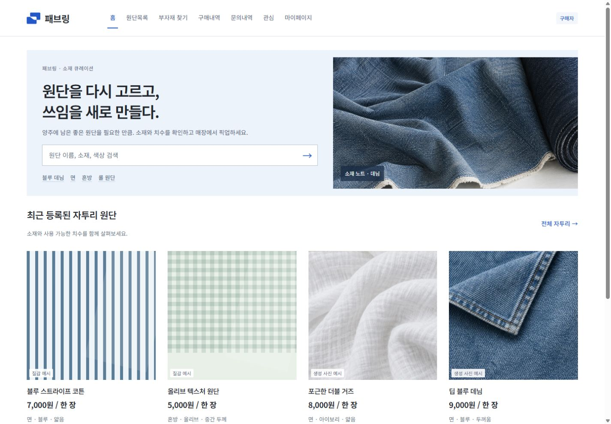
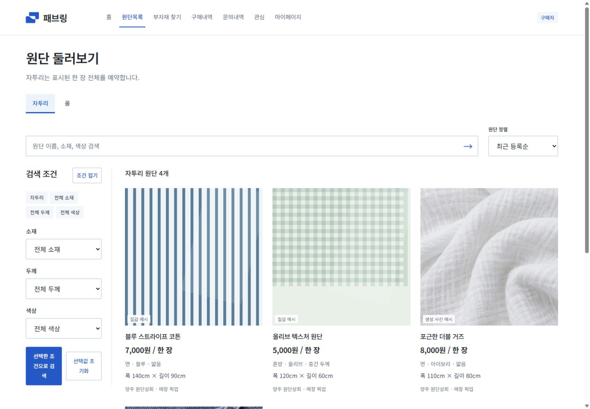
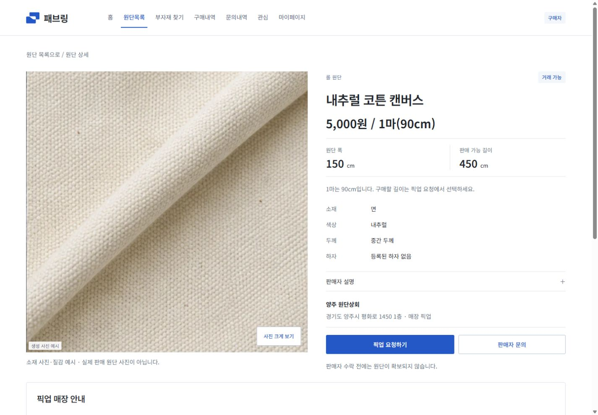
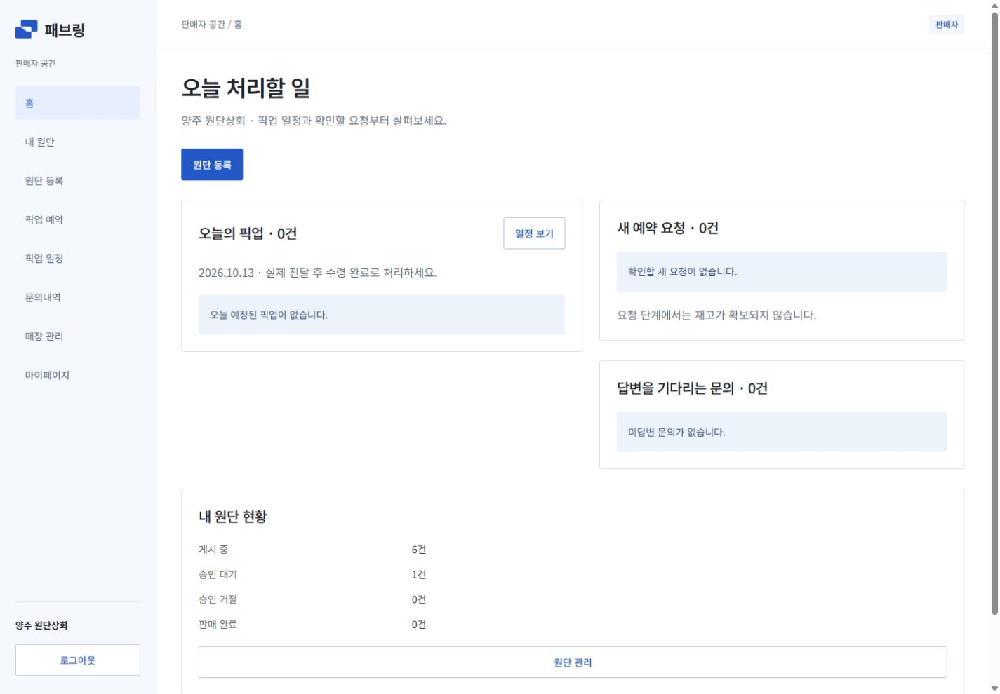
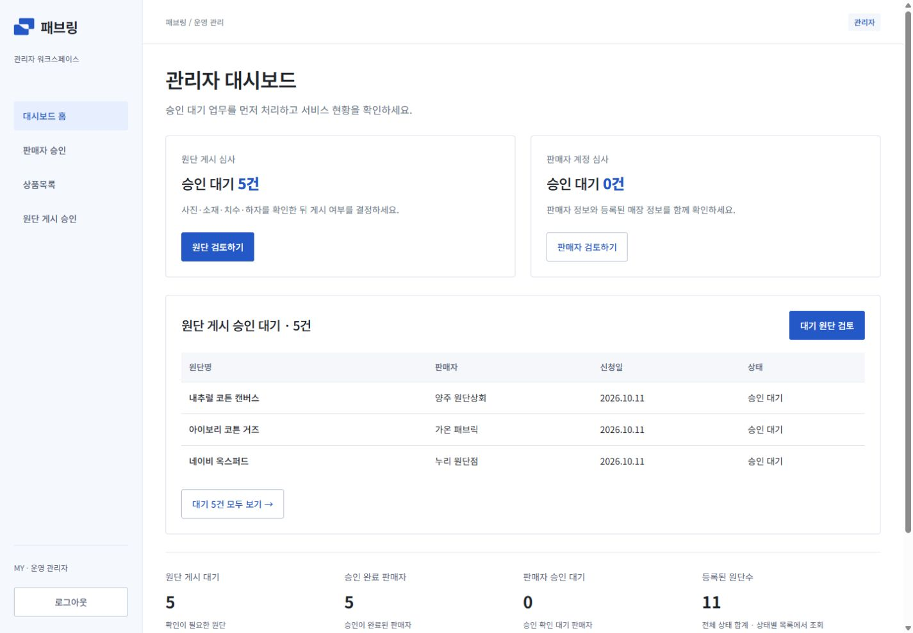
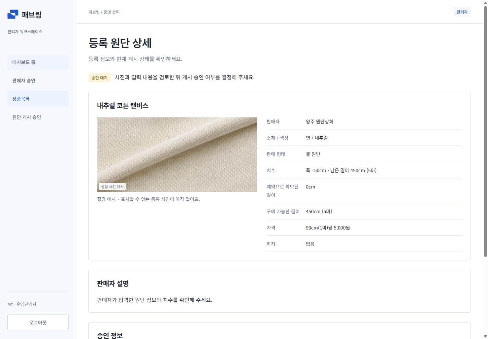
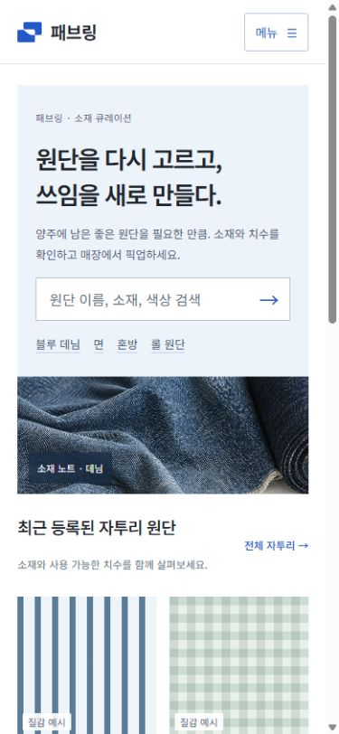
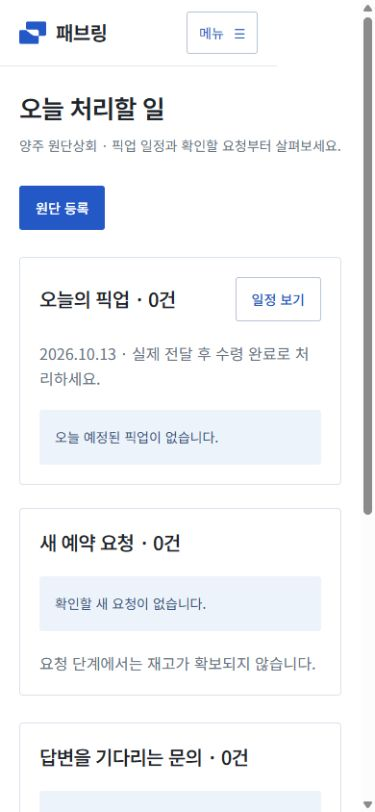
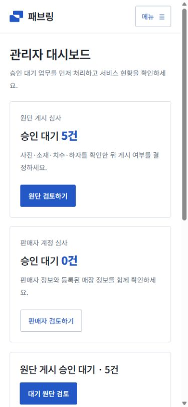

# 패브링 실제 서비스 UI 적용 및 로컬 검증

검증일: 2026-10-13 (KST). `main`의 기능 기준은 `12c78bb`이며, 이 기록은 그 위에 적용한 패브링 UI 변경의 커밋 전 검증이다. `deploy/team-shared`에도 같은 React 소스·브랜드 자산·테스트를 반영하고 별도로 빌드했다.

## 적용 내용

| 화면 | 변경 |
| --- | --- |
| 공통·로그인 | 코발트 `#2458C6`, 흰 배경, 선명한 본문과 얇은 경계선. 선택한 로고 02의 연결 원단 심볼을 유지하고 한글 **패브링**으로 통일. 역할별 메뉴·현재 위치·모바일 메뉴 정리. |
| 구매자 홈 | 데님 소재 사진, 간결한 소개, 바로 검색할 수 있는 입력창, 소재 바로가기와 최근 등록 자투리 원단. 실제 모드의 상품 사진은 API 사진만 사용. |
| 원단 목록 | 사진 비율과 정보 순서 통일: 이름 → 가격/단위 → 소재·색·두께 → 치수 → 매장. 데스크톱 필터와 모바일 접기, 검색·정렬·서버 페이지 유지. 검색 입력과 자투리/롤 전환 시 기존 조건 보존. |
| 원단 상세 | 가격·1마(90cm)/한 장·폭·구매 가능 길이를 먼저 표시. 사진 확대, 소재 표, 판매자 설명 펼침, 매장·문의·픽업 연결, 모바일 픽업 버튼. 관심 저장 기능 유지. |
| 판매자 | 오늘의 수락된 픽업 → 새 요청 → 미답변 문의 → 재고 순서로 배치. 등록 단계, cm/원 입력 단위, 오류 초점/스크롤, 사진 선택·뒤로 이동 시 입력 보존. AI는 기존 텍스트 대화·초안 수정 흐름을 유지. |
| 관리자 | 밝은 사이드 메뉴와 운영 헤더. 원단 게시 심사와 판매자 계정 심사를 대시보드 상단에 배치하고 실제 대기 합계를 연결. 원단 사진·소재·치수·하자·매장 정보와 승인/반려 행동을 구분. 모바일 목록·메뉴·입력 폭 정리. |

관리자 승인·반려 전에 최신 상태와 사진 조건을 확인하는 기존 로직, 반려 사유 검증, 확인 취소 시 선택 항목/사유 보존, 중복 처리 방지, 응답 불명확 시 잠금과 재조회는 유지했다. 구매자·판매자의 권한으로 관리자 API를 호출할 수 없다는 기존 회귀 테스트도 통과했다.

사진 중심 상품 탐색은 기존 29CM·SwatchOn·Nona Source 방향을 유지한다. 추가 참고는 [Nordweg](https://bestwebsite.gallery/sites/sotd/2018/07/12/nordweg)의 정돈된 목록, [Prime Bicycles](https://bestwebsite.gallery/sites/sotd/2021/07/16/prime-bicycles)의 사진/명세 배치, [Polaris](https://shopify.dev/docs/api/polaris)의 업무 행동·폼 피드백, [Todoist](https://www.todoist.com/ko)의 업무 우선순위, [Cadence](https://www.cadenceaba.com/#how)의 단계별 확인 흐름이다. 외부 UI 라이브러리나 새로운 기능 계약을 추가하지 않았다.

## 검증 결과

| 검증 | 결과 | 범위/증빙 |
| --- | --- | --- |
| 프론트엔드 전체 테스트 | **375/375 통과**, 양쪽 브랜치 각각 실행 | 기존 API·라우팅·권한·세션·재고·복구 회귀 + 검색 조건·판매 단위 신규 테스트 6개 |
| Oxlint | **오류·경고 0**, 양쪽 브랜치 | `npm.cmd run lint` |
| Vite 프로덕션 빌드 | **성공**, 양쪽 브랜치 | 역할별 지연 로딩. 초기 앱 JS **304.82KB / gzip 약92.66KB**, 500KB 초과 경고 해소 |
| 백엔드 전체 테스트 | **474/474 통과** | 변경하지 않은 백엔드 `7dc28c7`, 별도 테스트 DB |
| 실제 API adapter 연속 시나리오 | **42/42 통과** | [adapter-scenario.json](adapter-scenario.json): 가입·매장·승인·사진·추천·문의·예약·프로필·개발용 AI |
| 반응형 전체 화면 | **700/700 통과** | [responsive-checks.json](responsive-checks.json): 175개 고유 화면/상태 × 1440·768·390·320px. 문서 가로 넘침·렌더 실패·로드 완료 후 깨진 이미지·브랜드 표시 확인 |
| 실제 브라우저 서비스 흐름 | **28/28 통과** | [live-browser-checks.json](live-browser-checks.json): 실제 파일 선택·업로드, 관리자 승인/반려, 검색/관심/문의/예약, 판매자 수락/답변/수령 완료 및 재고 반영 |
| 양쪽 프로덕션 빌드 브라우저 | **15/15 통과**, 콘솔 오류 0 | [build-browser-checks.json](build-browser-checks.json): 구매자 홈/목록/상세, 판매자 홈, 관리자 홈/상세 각각 확인 + 모바일 역할별 메뉴 이동/닫힘 |

실제 서비스 흐름은 변경하지 않은 Express/PostgreSQL과 격리된 `material_loop_integrated_20261012_test` DB, 테스트 업로드 폴더에서 검증했다. 기존 로컬 업무 DB와 실제 사용자 계정은 사용하지 않았다. 롤 2마 요청·수락·수령 후 구매 가능 길이 900 → 720cm, 문의 답변, 관심 목록, 사진 없는 원단의 반려와 사유 보존까지 브라우저에서 확인했다. 로딩 중 제목/URL로 판단한 2항목은 최종 상태가 표시된 뒤 재확인했으며 해당 경위를 JSON에 기록했다.

로컬 브라우저에서 지속적인 렌더 오류나 가로 스크롤 문제는 발견하지 않았다. 네트워크 지연과 운영 트래픽의 성능 측정은 이 로컬 검증에 포함되지 않는다. AI 항목은 개발용 fake 제공자 검증이며 실제 모델 품질 검증은 아니다. 오라클의 서버·DB·HTTPS 배포 방식은 기존 협의 상태를 유지한다.

## 화면 증빙

아래는 **별도 정적 디자인 페이지가 아닌 실제 React 프로덕션 빌드의 예시 데이터 모드**다. 실제 모드의 거래·권한 동작은 위 브라우저 검증 기록에서 확인할 수 있다.

### 구매자

### 판매자

### 관리자

### 모바일

## 재검증

각 체크아웃에서 Node.js 24.18.0으로 `npm.cmd test`, `npm.cmd run lint`, `npm.cmd run build`를 실행한다. 빌드 확인은 `npm.cmd run preview` 후 `/#/preview`에서 역할별 시연 화면으로 진입한다. 실제 계정 흐름에는 백엔드와 격리 DB가 필요하며 자격 증명·로컬 환경 파일은 저장소에 포함하지 않는다.

브랜드 자산의 출처와 사용 범위는 [브랜드 자산 README](../../../public/assets/brand/README.md)에 있다. 기존 기능 기준과 배포 제한은 [통합 상태](../../INTEGRATION_STATUS.md)를 참고한다.
