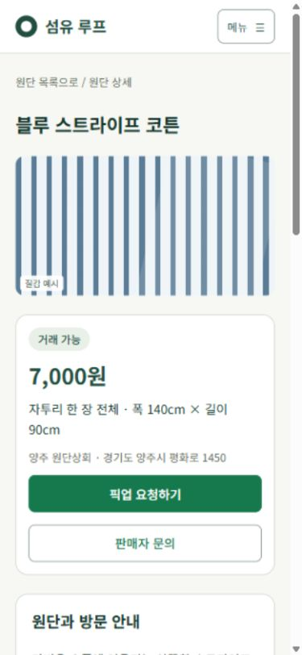
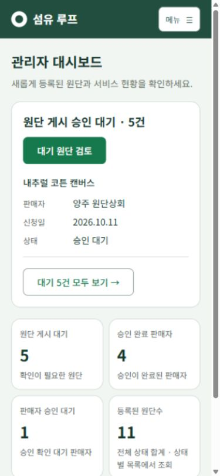

# 이용자 관점 UX/UI 수정 결과

2026-10-12 KST · React 작업본 · 기준 커밋 `7b99e5a`

[이전 검토 보고서](../user-perspective-2026-10-11/README.md)의 52개 항목을 **공통, 구매자, 판매자, 관리자** 네 묶음으로 나누어 반영했다. 기존 녹색·아이보리 색감과 역할별 업무 흐름을 유지하면서 정보 순서, 입력 보존, 확인 단계와 모바일 배치를 수정했다.

현재 React 및 시연 데이터 범위에서 **50개 항목의 화면·동작을 반영했고, C05와 S10은 문안·운영 절차 확정 대기**다. 아래의 ‘반영’은 실제 업무 API와 운영 정책까지 완성했다는 뜻이 아니다. 로그인·회원가입 외 업무 API 연동, 실제 사진 업로드와 AI 처리는 기존 진행 범위를 따른다. Figma와 보관용 HTML 참조본은 이번에 별도로 수정하지 않았다.

## 작업 묶음별 반영 내역

### 1. 공통·모바일

| 항목 | 반영 내용 | 상태 |
|---|---|---|
| C01 | 본문·입력 16px, 중요 안내·메타 14px, 행간 조정 | 반영 |
| C02 | 보조 글자·입력 힌트·상태 배지 대비 보정 | 반영 |
| C03 | 입력·일반 버튼 경계에 별도 진한 테두리 토큰 적용 | 반영 |
| C04 | 비밀번호 표시/숨기기, 8~72자 힌트 상시 표시 | 반영 |
| C05 | 약관·개인정보 내용 보기 다이얼로그, 닫기/Esc 후 입력·동의·초점 유지 | **문안 대기** |
| C06 | 가입 화면의 로그인 복귀 링크, 구매자·판매자 역할 이동 | 반영 |
| C07 | 기본 주소는 실제 로그인으로 진입, 운영 빌드 실제 모드에서 검토 도구 숨김. `/preview` 시연 유지 | 반영 |
| C08 | 글꼴을 WOFF2로 변환해 전체 글리프·가변 굵기를 유지하면서 전송 파일 축소 | 반영, 통신 지연 실측은 별도 |
| M01 | 모바일 헤더에 접이식 전체 메뉴, 홈 소개 축약 | 반영 |
| M02 | 모바일 필터 초기 접힘, 조건 요약과 사진 목록 유지 | 반영 |
| M03 | 상세 제목 → 사진 → 가격·단위·위치·픽업 버튼을 짧게 배치 | 반영 |
| M04 | 판매자 기본 입력을 사진보다 먼저 배치, 사진 슬롯 압축 | 반영 |
| M05 | 판매자 원단 표를 모바일 카드로 전환, 상태·수량·상세 버튼 노출 | 반영 |
| M06 | 관리자 모바일 헤더 압축, 대기 업무를 지표보다 먼저 배치 | 반영 |

공통 검토 중 추가로 발견한 달력 선택 후 키보드 초점 소실, 같은 주소의 메뉴를 눌렀을 때 메뉴가 남는 문제도 수정했다. 메뉴는 Esc로 닫을 수 있고 메뉴 버튼에 초점이 돌아간다.

### 2. 구매자

| 항목 | 반영 내용 |
|---|---|
| B01 | 수락된 예약에 ‘픽업 정보 보기’를 우선 표시. 매장 주소·일정·방문 안내·문의 연결 |
| B02 | 공개 문의와 개인정보 주의 안내를 입력란 위로 이동 |
| B03 | 조건 변경을 취소하면 마지막으로 적용한 검색 URL과 조건 복원 |
| B04 | 필터를 접거나 검색해도 상품 사진 유지 |
| B05 | 선택 조건 요약 표시, 중복된 조건 변경 동작 정리 |
| B06 | 답변 확인 후 해당 원단 상세로 이동 가능 |
| B07 | 원단 카드·상세에 판매처와 위치, 상세에 방문 안내 표시 |
| B08 | 픽업의 핵심 운영 규칙을 읽기 쉬운 안내 단위로 분리 |
| B09 | 파우치 제작 조건·재단 치수 버튼과 아이디어 예시를 구분 |
| B10 | ‘도안 미리보기’를 실제 제공 내용에 맞게 ‘재단 치수 확인’으로 변경 |
| B11 | 데스크톱 부자재 선택 시 스크롤 유지, 모바일에서는 결과에 초점 이동 |
| B12 | 스트라이프 상품에 맞는 질감 예시, 예시 표시 추가. 무관한 가짜 추가 사진 제거 |

픽업 주소는 해당 판매자의 **현재 매장 정보**다. 예약 당시 주소를 서버에서 보존하는 기능을 새로 만든 것은 아니며, 화면에도 현재 정보임을 표시했다. 실제 사진이 없을 때의 질감 이미지는 상품의 실물 사진이 아니다.

### 3. 판매자

| 항목 | 반영 내용 | 상태 |
|---|---|---|
| S01 | 문의별 답변 초안 유지, 실패 시 보존, 성공한 답변의 초안만 삭제 | 반영 |
| S02 | 문의 날짜·답변 시간을 한국 시간 형식으로 표시 | 반영 |
| S03 | AI 화면의 ‘사진 추가·내용 보완’으로 의미 명확화, 직접 입력의 사진 섹션에 초점 | 반영 |
| S04 | 선택한 사진 확인에서 등록 검토로 이어가기, 입력하던 위치로 복귀 | 반영 |
| S05 | 미선택 슬롯, 파일명, 선택 상태와 질감 예시를 구분 | 반영 |
| S06 | 부분 업로드 실패 시 상품명·전체/완료/재시도 수량·파일별 결과 표시 | 반영 |
| S07 | 달력 선택일 강조, 선택 날짜 결과 제목, 스크롤 유지 | 반영 |
| S08 | 대시보드·전체 달력을 월요일 시작으로 통일 | 반영 |
| S09 | 전체 프로필 저장 버튼을 독립된 공통 저장 영역으로 이동 | 반영 |
| S10 | 거절 사유 확인, 매장 정보 확인·수정과 상태 재조회 안내 | **공식 절차 대기** |
| S11 | 예약 수락·수령·취소 전후 실제/확보/판매 가능 길이를 비교 표시 | 반영 |
| S12 | 거절 0건이면 대시보드에서 불필요한 거절 사유 확인 유도 제거 | 반영 |
| S13 | 기존 매장 수정과 최초 등록 문구 구분 | 반영 |
| S14 | 신청 완료 후 ‘승인 대기 목록’을 주요 행동으로 지정 | 반영 |

초안 보존은 같은 API 인스턴스의 메모리 범위로, 새로고침·브라우저 재시작 후 영구 보관을 의미하지 않는다. 실제 파일 미리보기는 아직 없으며 선택 파일명과 예시 이미지를 명확히 구분했다. 파일별 업로드 결과는 시연 응답 기준이다. 재고 예측도 현재 화면 데이터 기준으로, 서버의 동시 예약 처리를 검증한 결과가 아니다.

### 4. 관리자

| 항목 | 반영 내용 |
|---|---|
| A01 | 지표의 숫자와 이동 대상 일치. 전체 원단 합계는 특정 상태 목록으로 잘못 연결하지 않음 |
| A02 | 판매자 승인·거절 시 대상과 효과 확인 후 확정, 취소 시 상태 유지 |
| A03 | 원단 확인 취소 후 원래 목록·필터·선택 원단·스크롤 복귀 |
| A04 | 게시 미리보기를 관리자 레이아웃 안에 표시하고 검토 화면 복귀 제공 |
| A05 | 제공된 사진 URL 목록·선택·확대 보기. 사진이 없으면 질감 예시임을 표시 |
| A06 | 판매자 매장명·이메일·식별자와 목록 건수 표시 |
| A07 | 확인 단계에서 중복된 상세를 줄이고 핵심 요약·사유·버튼을 가까이 배치 |
| A08 | 처리 결과를 한 번 표시하고 다음 대기 원단으로 연결 |
| A09 | 상태 필터를 목록에 바로 제공, 별도 필터 화면의 중복 이동 감소 |
| A10 | 원단 상태 탭 순서와 선택 스타일 통일 |
| A11 | AI 안내 문구를 실제 검토 범위에 맞게 중립적으로 수정 |
| A12 | 판매자 처리 효과를 상태 가까이에 표시 |

## 실행 화면 검증

브라우저 390×844, 좁은 가입 화면 320×780, 데스크톱 1440×900 및 관리자 검증 1352×937에서 확인했다. 아래 위치는 기본 시연 데이터와 당시 브라우저의 CSS 픽셀 기준이며 모든 화면 크기에 일반화하지 않는다.

| 항목 | 수정 전 | 수정 후 |
|---|---:|---:|
| 구매자 모바일 헤더 | 약 179px | 69px |
| 원단 목록 첫 상품 시작 | 약 y953 | y467 |
| 모바일 필터 영역 | 펼침 약 480px | 초기 접힘 120px |
| 상세 픽업 요청 버튼 | 약 y1210 | y612 |
| 판매자 직접 등록 첫 이름 입력 | 약 y1154 | y438 |
| 관리자 데스크톱 사이드바 | 기존 하단 정렬 유지 대상 | 높이 900px, 로그아웃 하단 여백 24px |

- 구매자: 적용한 필터 → 다른 조건 선택 → 취소 시 URL 정확히 복원. 검색 후 사진 유지. 문의 입력 전에 공개 안내 노출. 수락 예약에서 픽업 주소·일정·문의 접근 확인.
- 판매자: 답변 대기 ↔ 완료 왕복 후 초안 유지. 사진 확인 왕복 시 스크롤 1925px 복원. AI 보완 이동 시 사진 섹션 초점·안내 확인. 파일별 부분 실패 표시, 예약 수락 전 재고 450→270cm / 확보 0→180cm 확인.
- 관리자: 판매자 승인 취소 후 PENDING 유지, 확정 후 APPROVED. 두 번째 원단 선택 → 확인 취소 후 같은 원단·위치, 확정 후 대기 5→4건, 게시 미리보기에서 관리자 유지. 모바일 메뉴 이동 후 메뉴 닫힘.
- 가입: 320px에서 가로 넘침 없음. 비밀번호 표시/숨기기 후 값 유지. 약관 열기·닫기 후 닉네임 유지, 체크박스 자동 동의 없음, 호출 버튼에 초점 복귀.
- 키보드: 달력 날짜를 Enter로 선택한 뒤 스크롤 123px과 선택 날짜 초점 유지. 사진 검토 복귀 후 1925px과 ‘선택한 사진 확인’ 버튼 초점 복원. 현재 메뉴 재선택과 Esc 모두 메뉴 닫힘·메뉴 버튼 초점 복귀 확인.
- 운영 빌드: 해시 없는 주소에서 빈 실제 로그인 양식으로 진입, 개발용 ‘React 미리보기’ 도구 숨김 확인. 브라우저 오류 로그 없음.
- 확인한 모바일 목록·상세·등록·관리자 화면의 페이지 가로 넘침 없음. 표 카드는 상태와 상세 버튼을 세로 화면 안에 표시.
- 상태 변경은 격리된 시연 메모리에서 수행했다. 실제 계정·예약·문의·승인 데이터는 변경하지 않았다.

### 대표 화면

| 구매자 상세 | 관리자 대시보드 |
|---|---|
|  |  |

[원단 목록](screens/mobile-buyer-list.jpg) · [판매자 입력](screens/mobile-seller-register.jpg) · [판매자 원단 카드](screens/mobile-seller-fabrics.jpg) · [예약 확인](screens/mobile-reservation-confirm.jpg) · [약관 문안 대기](screens/mobile-policy-pending.jpg) · [데스크톱 관리자](screens/desktop-admin-approval.jpg)

## 색상·글꼴

- 공통 보조 글자 `#586b60`: 흰색 배경 5.70:1, 캔버스 배경 5.34:1.
- 입력 경계 `#829488`: 흰색 배경 3.21:1, 캔버스 배경 3.01:1.
- 경고 글자/배경 5.59:1, 회색 배지 글자/배경 5.25:1. 지정 색상 조합의 계산값이며 사이트 전체 접근성 인증 결과는 아니다.
- 글꼴 TTF 10,415,532바이트 → WOFF2 3,908,120바이트(**62.48% 감소**). 24,964개 글리프, Unicode 매핑 23,174개, 굵기 100~900, 이름 있는 인스턴스 7개 보존을 검증했다. 원본과 OFL은 유지했다.
- 브라우저 한국어 글꼴 적용을 확인했다. 캐시 없는 모바일 네트워크의 실제 로딩 시간은 측정하지 않았다.

## 자동 검증

- `npm test`: **108개 통과**, 실패 0개. 인증·역할 분리, 필터 복원, 승인 확인, 날짜 표시, 초안 보존, 업로드 부분 실패, 재고 변화와 초점/스크롤 복원 계약을 포함한다.
- `npm run lint`: 통과.
- `npm run build`: 통과.
- `git -c core.whitespace=blank-at-eol,blank-at-eof,space-before-tab,cr-at-eol diff --check`: 통과. 기존 Git 원본의 CRLF를 쓰는 판매자 파일 2개의 줄바꿈 형식은 유지했다.

테스트는 도메인·상태·서비스 동작을 검증한다. 화면 배치와 키보드 이동은 위 브라우저 확인 결과로 별도 기록했다.

## 남은 확정 사항과 검증 범위

1. **C05:** 사용자 답변 기준 확정 약관·개인정보 문안이 없다. `src/react/content/policies.js`는 pending 데이터이며 화면에는 ‘문안 준비 중’으로 표시한다. 확정 문안과 공개 전 가입 동의 정책을 팀에서 결정한 뒤 반영해야 한다.
2. **S10:** 공식 문의 창구·재검토 절차가 없다. 임의 연락처, 자동 재신청, 백엔드에 없는 처리 기능을 만들지 않았다. 팀에서 절차를 정하면 현재 안내에 연결한다.
3. 실제 업무 API·실제 사진 URL/업로드·AI 연동 검증은 별도다. 관리자 사진 확대는 URL 처리 로직과 UI를 구현했으나 제공된 시연 데이터에 실제 사진 URL이 없어 실제 등록 사진을 이용한 브라우저 검증은 하지 않았다.
4. 실물 휴대폰, Safari, 가상 키보드, 스크린리더 전체 검사와 모든 경로·해상도의 전수 회귀는 이번 검증 범위에 포함하지 않았다.

이 문서는 수정 결과와 인수 시 확인할 범위를 기록한다. 이전 피드백 문서는 당시 관찰 기록으로 유지한다.
